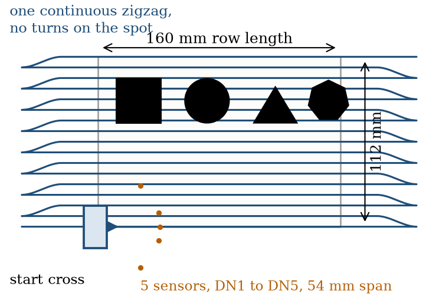
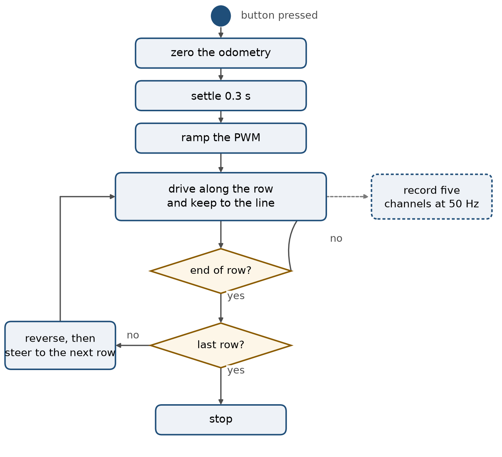
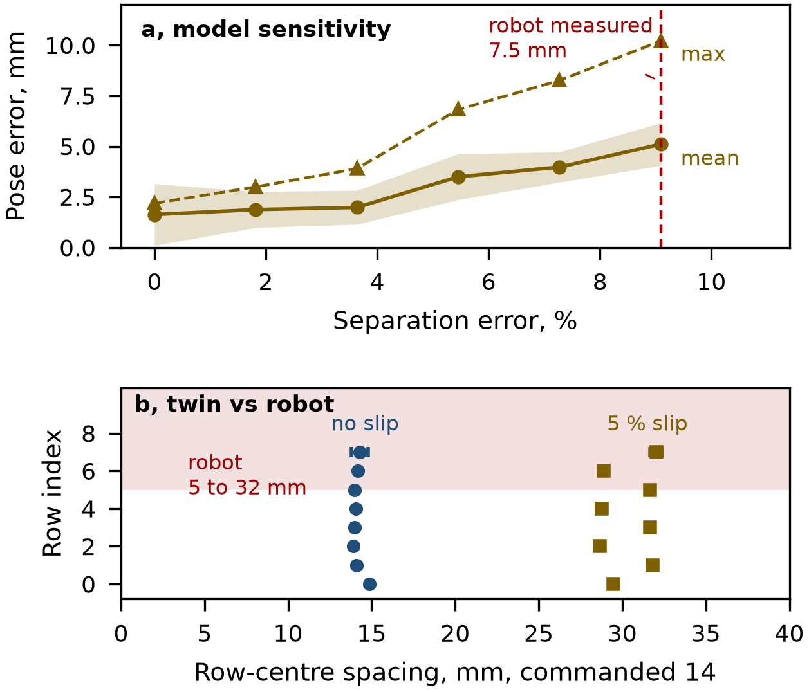
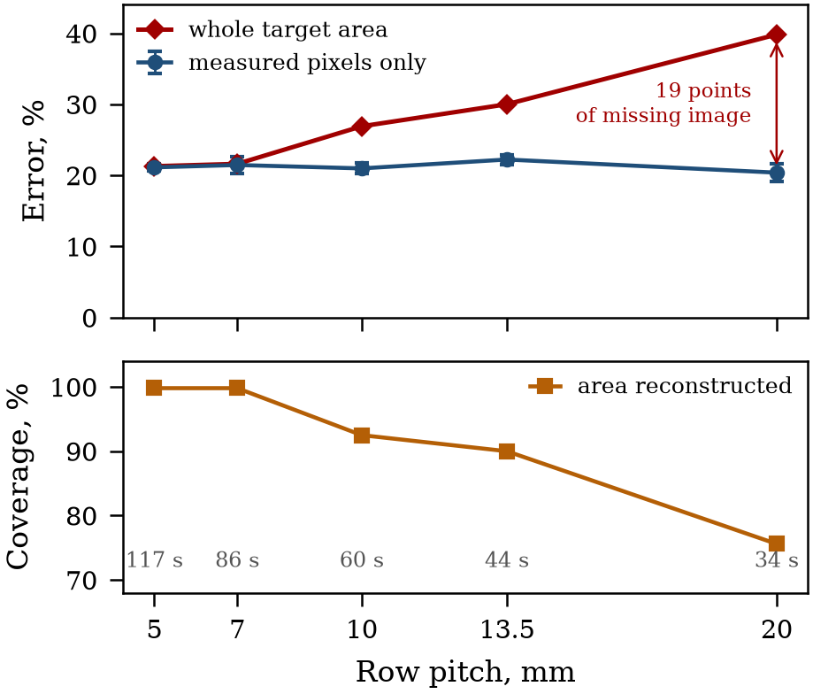
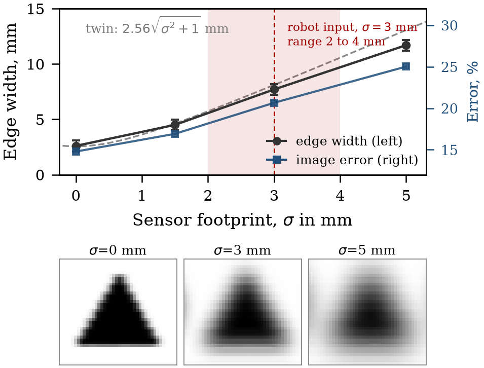

# Footprint or geometry? What limits a raster-scanned image in the digital twin

**SEMTM0043/42 — Assessment 2, Group Basis: Scientific Report**

*[7-digit student ID] · [7-digit student ID] · [7-digit student ID] · [7-digit student ID]*

---

## 1. Introduction

A small differential-drive robot carries five reflectance sensors that look at the floor. It drives up and down the sheet in a coverage pattern [5] and rebuilds a picture from the darkness of each reading. The encoders say where a reading was taken. The sensors say how dark the paper was. Together they produce the image that the task is judged on, as Figure 1 shows. The digital twin runs the same controller against a model of the same sheet at one pixel per millimetre. We use the twin to choose scan settings, so its fidelity matters in practice. A twin that overstates which features survive recommends settings that underperform at the bench.

Two explanations are available. The first is optical. Each sensor averages the paper over a finite spot, so edges must be softened [1, 2]. The second is geometric. Encoder odometry drifts because the controller's model of the wheels is not the robot's [3, 4], so samples are deposited in the wrong place.

> **Question.** At a row pitch of 7 mm and a pulse-width command of 30, which of three things limits the fidelity of the rebuilt image, the sensor's footprint, the row pitch we choose, or the controller's belief about wheel separation?

We predicted three things. The footprint sets a resolution floor of a few millimetres. A row pitch below that floor buys nothing. A geometry error large enough to be measured on the robot costs more fidelity than either.

**Figure 1.** The printed sheet and the scan path. The axle starts on the cross facing +x and odd rows are driven in reverse, so the robot never turns. The five sensors sit 28 to 41 mm ahead of the axle and within 27 mm of the centre line. Each reading is deposited at that sensor's position in the world frame.

## 2. Apparatus and control

The robot is driven by a state machine clocked at 100 Hz, and Figure 2 shows its logic. A scan starts from rest. The encoders are zeroed and the robot settles for 300 ms, so every run begins from the same pose. Each row is then driven with a 300 ms ramp. Two corrections act together. A heading hold with a gain of 60 PWM per radian and a clamp of plus or minus 15 PWM keeps the robot pointing along the row. A slower lane controller steers back onto the row line with a pure-pursuit law,

$$
\psi^\star = \psi_r + d\,\arctan\!\left(\frac{y_r-y}{L}\right),
\qquad |\psi^\star-\psi_r| \le 0.45\ \text{rad},
\tag{1}
$$

where ψ_r is the row heading, either 0 or π, *d* is plus or minus one for the direction of travel, *y* is the estimated lateral position and *L* is a lookahead of 35 mm. The lane change is spread over the 50 mm run-in past each end of the image, so the robot never turns on the spot. That choice is not cosmetic. In-place turns made the wheels scrub, and rows that should have been 14 mm apart were measured between 5 and 32 mm apart on the robot.

Readings are logged at 50 Hz, which bounds the spacing along a row at about 1.2 mm. Each sample holds the estimated pose and five channel readings. The rebuild deposits every reading at the estimated pose plus that channel's offset. The twin differs only in also knowing the true pose, so pose error can be measured instead of assumed.

**Figure 2.** State diagram of the controller. Rows alternate direction without turning. The run-in past each end of the image is where the robot steers onto the next row line. A 30 s guard stops the robot and reports a fault if a row makes no progress, which happens when the scan command is inside the motor deadband.

## 3. Experimental method

### Variables and conditions

Table 1 lists what was varied, what was measured and what was held fixed. Each condition was repeated ten times. In the twin a repeat differs only through the placement error of 1 mm and the start-heading error of 0.5° applied to the true pose. The sheet, the path, the speed and the sensor model were held fixed. Battery state was held roughly constant by charging before each session.

**Table 1.** Experiment variables. Every twin condition uses the calibrated parameter set unless stated. Each row has *n* = 10 runs.

| Type | Description |
|---|---|
| Independent | Row pitch 5, 7, 10, 13.5 and 20 mm, with rows adjusted so the scanned height stays 112 mm. Belief about wheel separation 82.5 to 90 mm, which is 0 to 9.1 % of the true value. Sensor footprint σ from 0 to 5 mm, run at 3 mm pitch. U-turn runs at 14 mm pitch with rotation efficiency from 0.8 to 1.0. |
| Dependent | Image error *E* in percent. Coverage *C* in percent. Pose error *e* in mm. Edge width *w* in mm. Row-centre spacing in mm. |
| Controlled | Sheet, 160 × 112 mm area, 7 mm pitch unless varied, command 30, 50 mm run-in, 300 ms settle, 100 Hz control, sensor offsets. |

### Metrics

Let *Î* be the rebuilt image and *S* the sheet, both scaled to [0, 1], and let *P* be the set of pixels that received at least one sample. Image error, coverage and pose error are then

$$
E=\frac{100}{|P|}\sum_{p\in P}\left|\hat{I}(p)-S(p)\right|,
\qquad
C=100\,\frac{|P|}{|P_A|},
\qquad
e_k=\left\|\hat{\mathbf{q}}_k-\mathbf{q}_k\right\|,
\tag{2}
$$

where |*P*A| is the nominal scan area in pixels, and **q̂**k and **q**k are the estimated and true sensor positions of sample *k*. *E* answers how much of the picture is wrong. *C* answers how much of it exists. *e*k is reported as a mean ē and a maximum *e*max because a small bias and a large excursion have different consequences.

Edges are characterised by their width from 10 to 90 percent of the transition. If the sensor is a Gaussian spot of standard deviation σ and the rebuild deposits each reading with a Gaussian of width *s*, a step edge returns as an error function and the width is

$$
w = 2.563\sqrt{\sigma^2+s^2},
\tag{3}
$$

with *s* = 1 mm for our rebuild. This is the line-spread relation used to turn a measured edge into a footprint estimate [6]. A trial counts as complete if the state machine reaches the end, which says nothing about quality, as the U-turn runs below show.

### Models compared

Two parameter sets are compared. *Nominal* is the template's ideal robot, with point sensors on a symmetric arc, 90 mm separation, no deadband and no lag. *Calibrated* uses our measured separation of 82.5 mm, a gain that gives the 58 mm s⁻¹ we measured at command 30, the measured sensor offsets and a 3 mm footprint. The controller's beliefs about the wheels are set apart from the physics, so a real odometry error is reproduced instead of simulated away.

### Procedure and analysis

A trial resets the pose, waits 1 s, scans and stops. The twin writes one file of pose, five sensor channels and state per sample, plus an image of the rebuild. The analysis is a script over those files. The robot contributes characterisation values instead of scored scans. These are wheel separation from a calibrated U-turn, 82.5 mm against the template's 90 mm, speed from scan logs, and row spacing measured with a rule after U-turn runs.

## 4. Results

Figure 3 compares the twin with the robot, Figure 4 varies the row pitch and Figure 5 varies the sensor footprint.

The template twin scores 15.2 percent with a spread of 4.2 in 123 s, and the calibrated twin 20.6 with a spread of 1.0 in 86 s. They differ in six parameters, so the gap of 5.4 points is a size and not a cause. A two by two comparison separates two of them. No footprint with a correct belief gives 13.3. Adding only the footprint gives 20.9. Adding only the template belief of 90 mm gives 21.2. Both give 25.2. The footprint is worth 5.8 points and the belief 6.1, and the interaction is minus 3.6, so the two errors overlap.

**Figure 3.** The twin against the robot. The upper panel plots pose error against the odometry model's wheel-separation error, with *n* = 10, shading of one standard deviation and the measured 7.5 mm marked. The lower panel plots row-centre spacing for the same 14 mm command, with the band measured on the robot.

In the upper panel the mean pose error grows from 1.6 to 5.1 mm and the maximum from 2.2 to 10.2 mm over 0 to 9.1 % belief error, a fourfold rise in the maximum, while the image error rises from 21.0 to 25.2 %. Growth is flat to 3.6 % and then accelerates. Our measured 7.5 mm sits at the top of the curve, which predicts 4 to 5 mm of mean error and maxima near 10 mm, larger than the 7 mm pitch. In the lower panel the twin gives one line at 14.2 ± 0.4 mm with no slip and two bands near 29 and 32 mm with 5 % slip, while the robot spans 5 to 32 mm. No single efficiency reproduces that spread, and the twin cannot go below 14 mm.

**Figure 4.** Image error against row pitch, with *n* = 10 per point. Blue scores only measured pixels, red scores the whole target and counts unmeasured area as wrong. Bars are one standard deviation. The lower panel gives coverage, with scan times.

Pitch matters only if the missing area counts. On measured pixels the error is flat, 20.4 to 22.2 % from 5 to 20 mm, while coverage falls from 99.8 to 75.6 % and time from 117 to 34 s. On the whole target the same runs rise from 21.3 to 39.8 %. The metric divides by the pixels that received a sample, so a quarter of the image is excluded at 20 mm, and the target rectangle is also shorter. For a task that must reproduce the sheet, the red series is the honest one.

**Figure 5.** Sensor footprint against edge sharpness at 3 mm pitch, with *n* = 10. The upper panel gives measured edge width, Equation 3 and image error. The band is our robot's 3 mm footprint, which is a calibration input. Below, the triangle at three footprints.

The edge width grows from 2.6 to 11.7 mm as the footprint goes from 0 to 5 mm. Equation 3 predicts 8.1 mm at 3 mm and 13.1 at 5 mm, against 7.7 and 11.7 measured, so the spot is not perfectly Gaussian. The image error rises from 14.8 to 25.0 %.

The U-turn runs show the metric failing. From efficiency 1.0 to 0.8 the mean pose error grows from 2 to 247 mm, yet the image error peaks at 39.3 % at 0.98 and falls to 30.8. Each channel is rescaled to its own range and the error counts only covered cells, so a scan that sees little is stretched and judged on what it reached.

## 5. Discussion and conclusion

### Interpretation

On measured pixels the footprint costs 5.8 points and the belief 6.1, and pitch costs nothing. On the whole target pitch costs 18.5. The ranking depends on the metric, and only the whole-target one matches the task. If the robot must deliver a picture, the missing quarter is error, and pitch is the largest effect.

The prediction was half right. The footprint does set a floor of about 8 mm. Geometry does not cost more than pitch. The twin is optimistic in a narrower sense than we claimed. An ideal sensor scores 15.2 against 20.6 for the calibrated twin, even though the template also has the wrong belief. That score says what an ideal sensor can see, not what the bench will do.

Two alternatives remain. The flat curve could be saturation, since detail between 1 and 3 mm is already lost at 3 mm. The robot's spread could be placement error rather than slip, which a rule cannot separate.

The trade-off is explicit. A 7 mm pitch gives 99.8 % coverage in 86 s. A 10 mm pitch gives 92.5 % in 60 s, with the same error, 21.0 against 21.5, and a lower pose error, 1.2 against 2.1 mm. If 92.5 % is enough, 10 mm wins. We chose 7 mm because the task is to reproduce the sheet.

### Limitations and next experiment

The limitation that most affects confidence is that the real side is a parameter set, not a scored scan. No rebuild from the robot is scored anywhere here, so the 5.4-point difference is model to model. It shows how far the model moves when the template is replaced. It does not show how far either is from the bench.

Three limits qualify the numbers. The repeats are rigid re-registrations of one deterministic scan, since only the start pose is randomised, so the bars measure sensitivity to placement. Several calibrated parameters, including the gain and the footprint, are estimates. And the error metric averages over a population that changes with the condition.

The next experiment follows directly. Scan the sheet once with the robot, score that log with the same rebuild and a fixed mask, and repeat three times. That number would turn the model-to-model gap into a model-to-data gap. A straight black and white edge at three speeds would then separate the footprint from the sensor delay, which is currently zero.

### Conclusion

The reconstruction is limited by three things at different scales. On the pixels sampled, the spot costs 5.8 points and the wheel belief 6.1. Across the whole target, pitch costs 18.5 points because it decides how much of the sheet is sampled. The twin's default metric reports only the first and hides the second, so a twin used to choose scan settings should score the full target. The robot is harder than its twin in a way the twin cannot show. Its row spacing spreads from 5 to 32 mm where the model gives a line.

---

## Evidence and sources

Twin runs are in `all_runs.csv`, with 300 rows and one row per twin run, written by `run_experiments.py`. It holds every condition used here, including the full U-turn sweep from 0.8 to 1.0 and the interaction cell with no footprint and the template belief. Per-run samples are in `exp/<condition>/runs/` and the rebuilds are in the matching `.png` files. The figures are produced by `analyse.py`, which reads only those files. The twin source is `DigitalTwin/`, where `ModelParameters.pde` holds the nominal and the calibrated sets. The robot firmware is in `Controller.cpp`, `ScanLog.cpp` and `dashboard/dashboard.html`. The headless driver used to batch the twin is `merge.py` plus a batch tab, and it does not change the behaviour of the sketch. Measured robot values are recorded in `ModelParameters.pde` and in the repository README. The twin is written in Processing [8].

## References

1. W. H. Richardson, "Bayesian-based iterative method of image restoration," *J. Opt. Soc. Am.* **62**(1), 55–59, 1972.
2. L. B. Lucy, "An iterative technique for the rectification of observed distributions," *Astron. J.* **79**(6), 745–754, 1974.
3. J. Borenstein and L. Feng, "Measurement and correction of systematic odometry errors in mobile robots," *IEEE Trans. Robotics Autom.* **12**(6), 869–880, 1996.
4. S. Thrun, W. Burgard and D. Fox, *Probabilistic Robotics*, MIT Press, 2005, ch. 5.
5. H. Choset, "Coverage for robotics, a survey of recent results," *Ann. Math. Artif. Intell.* **31**, 113–126, 2001.
6. G. D. Boreman, *Modulation Transfer Function in Optical and Electro-Optical Systems*, SPIE Press, 2001, ch. 3.
7. F. Tao, H. Zhang, A. Liu and A. Y. C. Nee, "Digital twin in industry, state of the art," *IEEE Trans. Ind. Informat.* **15**(4), 2405–2415, 2019.
8. Processing Foundation, *Processing 4 reference*, processing.org, accessed 2026.
